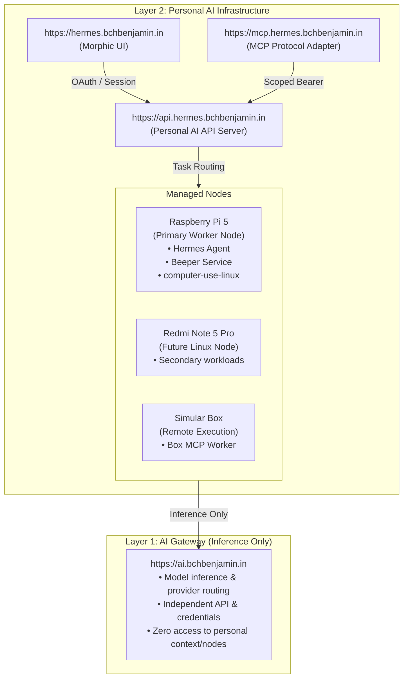

# Personal AI Infrastructure

Canonical repository and source of truth for personal AI infrastructure, node orchestration, messaging integrations, and remote execution environments.

---

## 1. Overview & Two-Layer Architecture

This infrastructure enforces a strict two-layer isolation boundary between external model inference and personal context execution.



### Strict Isolation Guarantees
1. **Layer 1 (AI Gateway)**:
   - Primary domain: `https://ai.bchbenjamin.in`
   - Purpose: Model inference, routing (Anthropic, OpenAI, custom models).
   - Boundary: Has **zero** access to personal files, credentials, sessions, memory, or local nodes.
   - Directionality: Nodes call AI Gateway for completions; AI Gateway can **never** initiate calls into Layer 2.
2. **Layer 2 (Personal AI Infrastructure)**:
   - Frontend: `https://hermes.bchbenjamin.in` (Morphic UI).
   - API: `https://api.hermes.bchbenjamin.in` (Personal AI API & Control Plane).
   - MCP Interface: `https://mcp.hermes.bchbenjamin.in` (MCP protocol adapter over Personal AI API).
   - Role: Orchestration, memory, node management, device operations, messaging, and system management.

---

## 2. Directory Structure

```text
personal-ai-infrastructure/
├── README.md               # Infrastructure documentation and runbook index
├── ARCHITECTURE.md         # Detailed architectural boundaries and design
├── SECURITY.md             # Security model, scopes, and secret scanning rules
├── CONTRIBUTING.md         # Development guidelines and contribution policies
├── CHANGELOG.md            # Release and modification history
├── LICENSE                 # MIT License
├── .gitignore              # Strict secret and ephemeral state exclusion
│
├── docs/                   # Architectural decisions, runbooks, and recovery guides
│   ├── architecture/       # Layer isolation, data flow, and threat modeling
│   ├── decisions/          # Architecture Decision Records (ADRs)
│   ├── deployment/         # Pi 5, network, and node deployment runbooks
│   ├── security/           # Permission matrices and audit logging schemas
│   └── recovery/           # SSD recovery and disaster recovery procedures
│
├── control-plane/          # Node registry, task routing, auth, and audit
├── personal-ai-api/        # FastAPI server backing api.hermes.bchbenjamin.in
├── mcp/                    # MCP server adapter and tool definitions
├── node-agent/             # Node daemon, command runner, and systemd adapters
├── integrations/           # Hermes, Beeper, computer-use-linux, Simular Box
├── nodes/                  # Node specifications (Pi 5, Redmi, Simular Box)
├── deployment/             # Idempotent install, upgrade, rollback, and backup scripts
├── upstreams/              # Upstream dependency manifest (pinned versions)
├── backups/                # Backup policies and recovery documentation
└── tests/                  # Unit, integration, and security verification tests
```

---

## 3. Node Fleet

| Node ID | Hardware / Platform | Role | Connectivity | Status |
| :--- | :--- | :--- | :--- | :--- |
| `pi5` | Raspberry Pi 5 (4 GB RAM, 64 GB microSD, 256 GB SSD) | Primary node: Hermes, Beeper, computer-use-linux | Tailscale (`100.73.46.31`) | Active / Verified |
| `redmi` | Redmi Note 5 Pro (Snapdragon 636, Linux rootfs) | Future edge node: Beeper mirror, testing workloads | Tailscale | Staged |
| `box` | Simular Box (Ubuntu 24.04 x86_64 cloud container) | Auxiliary remote browser & compute sandbox | HTTPS / MCP | Configured |

---

## 4. Key Operational Runbooks

- **Deploying a Node**: [deployment/install/bootstrap-node.sh](file:///home/bchbenjamin/personal-ai-infrastructure/deployment/install/bootstrap-node.sh)
- **Raspberry Pi 5 Runbook**: [docs/deployment/pi5-runbook.md](file:///home/bchbenjamin/personal-ai-infrastructure/docs/deployment/pi5-runbook.md)
- **Backing Up Configuration & State**: [deployment/backup/backup-config.sh](file:///home/bchbenjamin/personal-ai-infrastructure/deployment/backup/backup-config.sh)
- **Restoring from Disaster**: [docs/recovery/backup-restore-guide.md](file:///home/bchbenjamin/personal-ai-infrastructure/docs/recovery/backup-restore-guide.md)
- **Revoking Client Credentials**: [docs/security/permission-matrix.md](file:///home/bchbenjamin/personal-ai-infrastructure/docs/security/permission-matrix.md)

---

## 5. Security & Secret Hygiene

This repository is **completely free of secrets**. All credentials, API tokens, session cookies, database files, and keyrings are injected via environment variables (`.env` mode `0600`) or secure credential managers. CI includes automated regex secret scanning.
